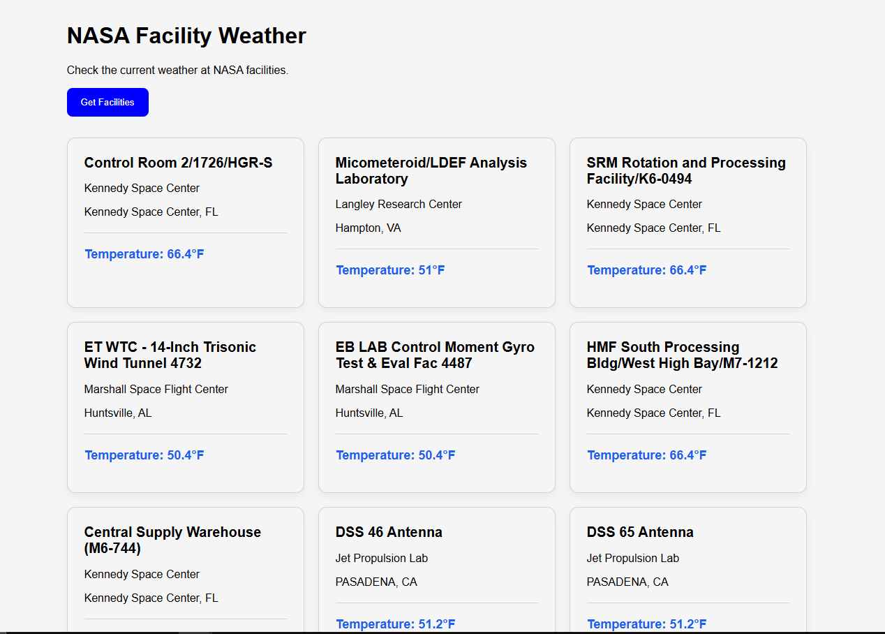

# NASA Facility Weather

A web application that retrieves NASA facility information and displays location-based weather data in a clean, responsive interface.

Built with HTML, CSS, and JavaScript, the application combines NASA facility data with the Open-Meteo weather API to make it easy to explore NASA locations and view their current temperatures in one place.

## Live Demo

**[View NASA Facility Weather](https://anwaralshohatee.github.io/nasa-facilities/)**

## Technologies


## Features

- Retrieve NASA facility data with a single click
- Display facility names, NASA centers, cities, and states
- Fetch current temperature data based on facility coordinates
- Display temperatures in Fahrenheit
- Dynamically generate facility cards using JavaScript
- Organize facilities in a responsive CSS grid
- Handle missing location data and weather API errors
- Combine data from multiple external APIs

## Screenshot



## How It Works

1. Click **Get Facilities** to retrieve NASA facility information.
2. The application processes the returned data and generates a card for each facility.
3. Each card displays the facility name, NASA center, and location.
4. When coordinates are available, the application requests the current temperature from Open-Meteo.
5. The temperature appears on the corresponding facility card.

## Getting Started

### 1. Clone the Repository

```bash
git clone https://github.com/AnwarAlshohatee/nasa-facilities.git
cd nasa-facilities
```

### 2. Run the Application

Open `index.html` in your browser.

No additional dependencies or installations are required.

An internet connection is required to retrieve NASA facility and weather data.

## APIs Used

**NASA Open Data**

Provides information about NASA facilities, including names, associated centers, locations, and geographic coordinates.

**Open-Meteo Weather API**

Provides current temperature data using each facility's latitude and longitude.

## Future Improvements

- Add search and filtering by facility name or location
- Display additional weather conditions
- Integrate an interactive map of NASA facilities
- Add loading indicators and pagination
- Improve API reliability and request handling

## Author

**Anwar Alshohatee**

[Portfolio](https://anwaralshohatee.netlify.app) | [LinkedIn](https://www.linkedin.com/in/anwaralshohatee/)
